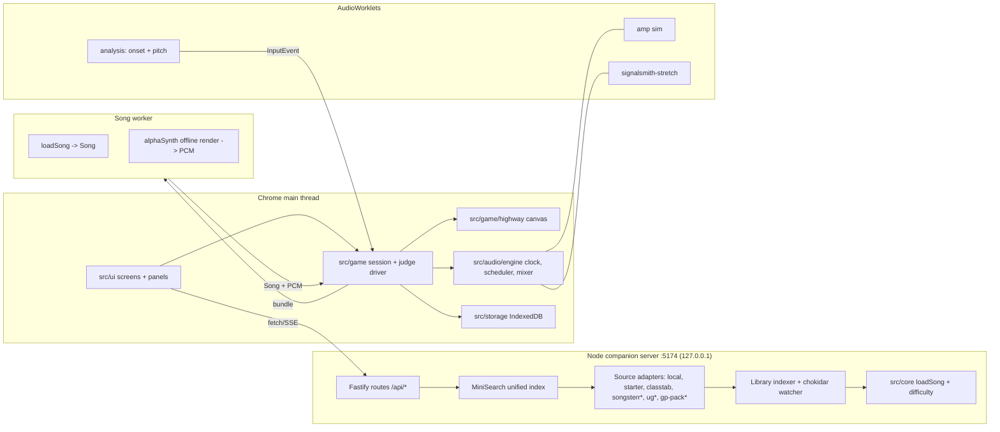

# Architecture

## Summary
- **Four execution contexts:** browser main thread (UI, game loop, judge), AudioWorklets (analysis,
  amp sim, time-stretch), a Web Worker (song load + offline guide-synth render), and the Node companion
  server (library index, sources, file I/O). One `AudioContext` is the only clock.
- **One song model** (`shared/song.ts`). Every importer (alphaTab for GP/MusicXML/alphaTex, our ASCII
  parser, ClassTab MIDI pairing) produces it; the game, renderer, difficulty and judge consume only it.
- **Isomorphic core.** `src/core/` is pure TS (no DOM, no Web Audio). The server imports it for
  indexing (metadata, difficulty); the browser worker runs the same `loadSong()` to play.
- **Storage:** song files on disk (library folder, ClassTab data dir, `starter/`); progress, scores,
  settings and audio links in IndexedDB; server-side config, index cache, sidecars and copied
  backing audio under the data dir (`~/.riffway/`).
- **Contracts are frozen by T-010** (`shared/*` types + stub modules). Tasks only add files in their
  own area; a contract change is flagged in `TASKS.md` first.

## Module map

`*` link-out adapters: no network I/O, only URLs and local title/artist matching.

## Process boundaries
| Context | Owns | Talks via |
|---|---|---|
| Server | Filesystem, watcher, ClassTab download, search index, sidecars, copied audio | HTTP JSON + SSE on `/api/*` |
| Main thread | UI, game session, judge, renderer (reads clock only), IndexedDB | `postMessage` to worker/worklets |
| Song worker | alphaTab import, `MidiFileGenerator`, offline synth render | Transferable `Float32Array` PCM + `Song` JSON |
| Analysis worklet | Onset/pitch DSP from `src/core/dsp/` | `port.postMessage(AnalysisEvent)` (`shared/audio-events.ts`) |
| Amp worklet | Oversampled clipper + tone stack | AudioParams + `port` for preset changes |
| Stretch worklet | Backing-audio speed change (signalsmith-stretch) | Its own `schedule()` API |

The server binds to `127.0.0.1` only. The browser never contacts a third-party site except by opening
a link-out URL in a new tab.

## Data flow: import → model → game
1. A file lands in the library folder (drag-drop → `POST /api/library/import`, or manual copy), in the
   ClassTab data dir (`npm run classtab:refresh`), or ships in `starter/`.
2. The watcher debounces, then the indexer runs `loadSong()` (`src/core/import/load-song.ts`):
   format detect → importer → `Song` → `analyzeDifficulty()` → `IndexEntry` (meta, arrangements,
   rhythm status, difficulty, tuning, tags). Entries go into MiniSearch and the JSON index cache.
3. The UI searches (`GET /api/search`), the user picks a result and arrangement.
4. `GET /api/songs/:id` returns `SongMeta` with file URLs; the browser fetches the bundle (main file,
   optional paired MIDI, optional sidecar) and posts it to the song worker.
5. The worker returns the `Song` (same code as step 2) and renders guide PCM at the current speed.
6. The game session schedules guide/backing/metronome on the engine clock, the renderer draws from
   `songTime`, input events (guitar worklet or keyboard) go to the judge, results go to IndexedDB.

## Directory layout and owners (D9)
| Path | Contents | Owner task |
|---|---|---|
| `shared/` | Contracts (types only): `song.ts`, `sources.ts`, `api.ts`, `audio-events.ts`, `clock.ts`, `judge.ts`, `settings.ts`, `storage.ts`, `ui.ts` | T-010 (frozen) |
| `src/core/model/`, `src/core/import/{alphatab,load-song,fret-assign}` | Model helpers, alphaTab importer | T-011 |
| `src/core/import/{ascii,align,midi}/` | ASCII parser, ruler/MIDI rhythm, alignment math | T-012 |
| `src/core/{difficulty,handpos}/` | Difficulty, hand positions | T-013 |
| `src/core/{judge,practice}/` | Judge, scoring, speed trainer, loop math | T-014 |
| `src/core/dsp/` (pitch, onset, fft, level) | Analysis DSP | T-015 |
| `src/core/dsp/amp/` | Amp DSP | T-023 |
| `src/core/progress/`, `src/storage/` | Mastery, streaks, recommendations; IndexedDB, export | T-020 |
| `src/audio/engine/` | Context, clock, scheduler, metronome, mixer, transport | T-016 |
| `src/audio/{guide,input,monitor,backing,calibration}/` + their worklets | Audio features | T-021, T-022, T-023, T-027, T-033 |
| `src/game/highway/` · `src/game/{session,input}/` | Renderer · session, keyboard/guitar input | T-024 · T-031 |
| `src/ui/{shell,design,components}/`, `src/main.ts` | App shell, design system | T-018 |
| `src/ui/screens/<name>/`, `src/ui/panels/<name>/` | One owner each (see TASKS.md) | various |
| `server/` core, `server/routes/<area>.ts`, `server/sources/<id>/` | Server, one route file per area | T-017, T-025, T-026, T-027, T-028 |
| `starter/` | Starter library | T-019 |

T-010 pre-creates every route file, screen, panel and cross-task module as a stub with its final
export signature, plus registries (`server/routes/index.ts`, `server/sources/registry.ts`,
`src/ui/screens/index.ts`, `src/ui/panels/index.ts`), so no later task edits a shared file.

## Companion server API
All JSON unless noted; DTOs in `shared/api.ts`.
| Method & path | Purpose | Owner |
|---|---|---|
| `GET /api/health` | `{ok, version, dataDir, libraryDir}` | T-017 |
| `GET, PUT /api/config` | Server config: library folder, enabled sources | T-017 |
| `GET /api/sources` | Adapters with status (indexed count, last refresh, link-out) | T-017 |
| `GET /api/search?q&source&tierMin&tierMax&tuning&playable&tags&limit` | Unified search → `{results, linkOuts}` | T-017 (+adapters) |
| `GET /api/songs/:id` | `SongMeta`: arrangements, rhythm status, difficulty, file URLs | T-017 |
| `GET /api/songs/:id/file` | Raw main file bytes | T-017 |
| `GET /api/songs/:id/rhythm` | Paired MIDI bytes (ClassTab / sibling `.mid`) | T-025 |
| `GET, PUT /api/songs/:id/sidecar` | Rhythm-alignment sidecar JSON | T-028 |
| `POST /api/library/import` | Multipart drag-drop import into the library folder | T-017 |
| `POST /api/library/paste` | Save a pasted ASCII tab (+ sidecar) | T-028 |
| `POST /api/library/rescan` | Full rescan | T-017 |
| `GET /api/events` | SSE: `library.changed`, `index.progress`, `classtab.progress` | T-017 |
| `GET /api/classtab/status`, `POST /api/classtab/refresh` | ClassTab state / refresh | T-025 |
| `POST /api/audio`, `GET /api/audio/:id`, `DELETE /api/audio/:id` | Copy, serve, remove backing audio | T-027 |
| `GET, POST /api/sidecars` | Bulk sidecars for export/import | T-028 |

Production (`npm start`) serves `dist/` and the API on 5174. Dev (`npm run dev`) runs Vite on 5173
with `/api` proxied to 5174 (D7).

## Storage
| Where | What |
|---|---|
| Library folder (default `~/Music/Tabs`, in server config) | User's song files; drag-drop and paste write here |
| Data dir `~/.riffway/` (`RIFFWAY_DATA_DIR` overrides) | `config.json`, `index.json` (index cache), `classtab/` (zip, extracted, ETag), `sidecars/<songId>.json`, `audio/<sha1>.<ext>` |
| `starter/` (repo) | Starter `.atex` files + `manifest.json`, read-only source `starter` |
| IndexedDB `riffway` | settings, runs, bests, sectionProgress, practiceDays, streak, audioLinks — see [progress.md](progress.md) |

**Song identity (DEC-14).** `songId = <source>:<first 16 hex of sha1(content)>` at first index; the
index keeps the id for that path when the content later changes, and a moved file with identical
content keeps its id. Starter ids are `starter:<slug>`. An *arrangement* is `(songId, trackIndex)`;
only 6-string guitar tracks are playable.

## Testing layers
Unit (Vitest, Node) for everything in `src/core/` and `server/`; Vitest browser mode (Playwright
Chromium) for `OfflineAudioContext` graph tests (`*.browser.test.ts`); audio-pipeline tests with
generated tones and recorded clips; Playwright e2e in keyboard mode with a `?e2e=1` test hook
(`window.__riffwayTest`) that injects input through the same judge path.
